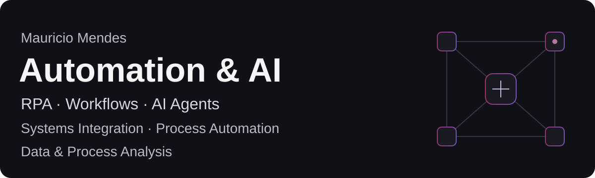
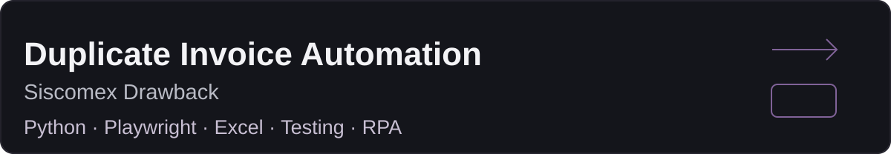

[English](README.md) · [Português do Brasil](README.pt-BR.md)

## About me

I focus on **Automation & AI**, bringing an operational perspective to process and data analysis. I map how work happens, uncover business rules, investigate exceptions and turn process problems into automation requirements.

My direction connects **RPA, workflow automation, AI agents and systems integration**. I develop my practice through concrete projects, targeted learning and evidence-driven validation.

## What I build

My work and learning focus on these areas:

| Processes & systems | Automation & AI |
| --- | --- |
| Process Automation | RPA |
| Workflow Automation | AI-assisted Automation |
| Systems Integration | AI Agents |
| Process Optimization | Browser Automation |

## How I build

**Problem → Map → Automate → Validate → Learn**

Understand the outcome. Map the process, rules and risks. Build with AI assistance where useful. Test the behavior against evidence. Learn from real exceptions and refine the approach.

Human judgment sets the business rules and safety boundaries; validation determines what can be claimed.

## Toolbox

| Tools / areas | Current state | Scope |
| --- | --- | --- |
| Playwright · Excel | CONFIRMED | Practical browser automation and professional spreadsheet use |
| Git · GitHub | CONFIRMED | Basic repository and documentation-publication practice |
| n8n · UiPath · AI Agents | LEARNING | Current study and professional direction |
| Python · APIs | UNKNOWN | Python was used in AI-assisted project implementation; independent proficiency and practical API experience are not established |

These states describe evidenced practice or learning, not seniority.

## Projects

### Featured Project #01

An anonymized case of browser automation for duplicate invoices, with explicit validation and failure recovery. I led process mapping, business rules and real-system testing; AI assisted implementation.

[View Case Study →](https://github.com/MauMendesz/siscomex-duplicate-invoice-automation-case-study)

Historically functional and validated; current recovered runtime remains unvalidated. Operational code and corporate data stay private.

## Connect

[LinkedIn](https://www.linkedin.com/in/mauricio-nascimento-mendes-336b072a8/) · [GitHub](https://github.com/MauMendesz) · [Email](mailto:mauriciodevmendes@gmail.com)

[English](README.md) · [Português do Brasil](README.pt-BR.md)
