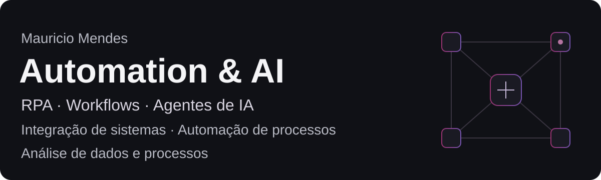
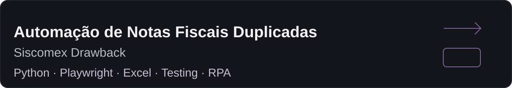

[English](README.md) · [Português do Brasil](README.pt-BR.md)

## Sobre mim

Meu foco é **Automation & AI**, com uma perspectiva operacional sobre análise de dados e processos. Mapeio como o trabalho acontece, identifico regras de negócio, investigo exceções e transformo problemas de processo em requisitos de automação.

Minha direção conecta **RPA, automação de workflows, agentes de IA e integração de sistemas**. Desenvolvo minha prática por meio de projetos concretos, aprendizado direcionado e validação baseada em evidências.

## O que construo

Meu trabalho e aprendizado se concentram nestas áreas:

| Processos e sistemas | Automação e IA |
| --- | --- |
| Automação de processos | RPA |
| Automação de workflows | Automação assistida por IA |
| Integração de sistemas | Agentes de IA |
| Otimização de processos | Automação de navegador |

## Como trabalho

**Problema → Mapear → Automatizar → Validar → Aprender**

Entender o resultado esperado. Mapear o processo, as regras e os riscos. Construir com apoio de IA quando útil. Testar o comportamento com evidências. Aprender com exceções reais e refinar a abordagem.

O julgamento humano define as regras de negócio e os limites de segurança; a validação determina o que pode ser afirmado.

## Ferramentas e áreas

| Ferramentas / áreas | Estado atual | Escopo |
| --- | --- | --- |
| Playwright · Excel | CONFIRMED | Prática em automação de navegador e uso profissional de planilhas |
| Git · GitHub | CONFIRMED | Prática básica de repositório e publicação documental |
| n8n · UiPath · AI Agents | LEARNING | Estudo atual e direção profissional |
| Python · APIs | UNKNOWN | Python foi usado na implementação assistida por IA; proficiência independente e experiência prática com APIs não estão estabelecidas |

Esses estados descrevem prática evidenciada ou aprendizado, não senioridade.

## Projetos

### Projeto em destaque #01

Case anonimizado de automação de navegador para notas fiscais duplicadas, com validação explícita e recuperação de falhas. Conduzi o mapeamento de processos, as regras de negócio e os testes no sistema real; a IA apoiou a implementação.

[Ver o case →](https://github.com/MauMendesz/siscomex-duplicate-invoice-automation-case-study)

Historicamente funcional e validado; o runtime recuperado atual permanece sem validação. Código operacional e dados corporativos continuam privados.

## Contato

[LinkedIn](https://www.linkedin.com/in/mauricio-nascimento-mendes-336b072a8/) · [GitHub](https://github.com/MauMendesz) · [E-mail](mailto:mauriciodevmendes@gmail.com)

[English](README.md) · [Português do Brasil](README.pt-BR.md)
